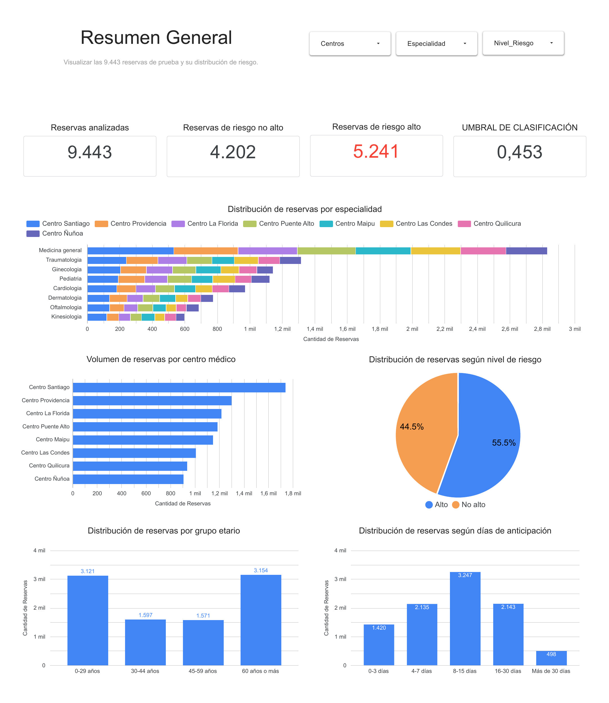
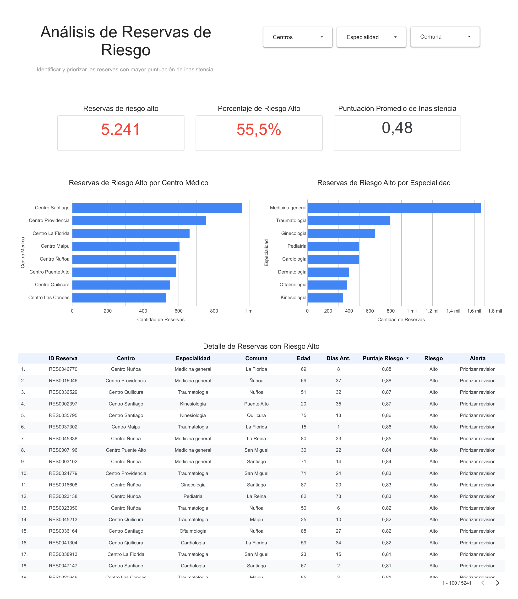
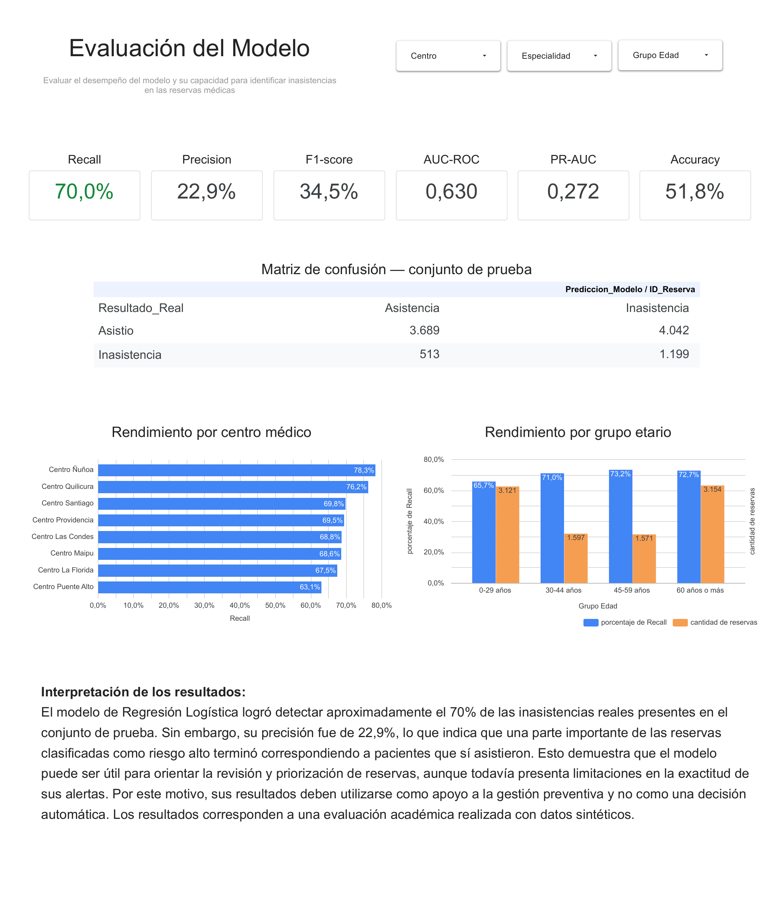

# SaludConex — Sistema de predicción de inasistencias médicas

Proyecto académico de **Ciencia de Datos** desarrollado para la asignatura **Gestión de Proyectos de Datos (SCY1102), Duoc UC**. El caso de trabajo representa una red ficticia de centros médicos y el conjunto de datos usado para el prototipo es sintético.

El proyecto desarrolla un flujo reproducible de análisis y clasificación para **priorizar reservas que podrían requerir acciones preventivas**. El puntaje del modelo es un apoyo a la revisión administrativa: no corresponde a una probabilidad calibrada, no sustituye decisiones humanas y nunca debe utilizarse para cancelar o negar una atención.

> **Estado del repositorio:** contiene el notebook, el dataset sintético, las dos exportaciones CSV, la evidencia del dashboard y un borrador del informe. El informe todavía tiene campos `[COMPLETAR]`; no se presenta como versión final de entrega.

## Resumen del proyecto

| Elemento | Resultado |
|---|---|
| Registros sintéticos originales | 50.000 |
| Variables originales | 18 |
| Reservas canceladas excluidas del modelamiento | 2.988 |
| Registros considerados para modelamiento | 47.012 |
| Entrenamiento | 37.569 |
| Prueba | 9.443 |
| Modelo seleccionado | Regresión Logística |
| Umbral de clasificación | 0,453325 |
| Dashboard | Looker Studio, 3 páginas |

### Distribución del resultado en el dataset original

| Resultado | Registros | Porcentaje |
|---|---:|---:|
| Asistió | 38.562 | 77,12 % |
| Inasistencia | 8.450 | 16,90 % |
| Cancelada | 2.988 | 5,98 % |

Las reservas canceladas se excluyeron porque el objetivo del prototipo es identificar inasistencias sin aviso, no predecir cancelaciones.

## Resultados del modelo

Evaluación sobre el conjunto de prueba de **9.443 reservas**:

| Métrica | Resultado |
|---|---:|
| Accuracy | 0,518 |
| Precision | 0,229 |
| Recall | 0,700 |
| F1-Score | 0,345 |
| AUC-ROC | 0,630 |
| PR-AUC | 0,272 |

Matriz de confusión (filas = resultado real, columnas = predicción):

| | Predijo asistencia | Predijo inasistencia |
|---|---:|---:|
| Asistió | 3.689 | 4.042 |
| Inasistencia | 513 | 1.199 |

El modelo identifica alrededor del 70 % de las inasistencias del conjunto de prueba, pero su Precision de 22,9 % implica una cantidad importante de falsas alertas. Por ello, se plantea como prototipo de priorización, no como sistema de decisión automática.

**Interpretación del campo `Puntaje_Inasistencia`:** es un puntaje numérico de riesgo no calibrado, utilizado para ordenar reservas. Aunque está expresado entre 0 y 1, no debe leerse como una probabilidad real exacta de inasistencia.

## Estructura del repositorio

```text
SaludConex_GitHub_2026/
├── README.md
├── requirements.txt
├── .gitignore
├── .gitattributes
├── notebooks/
│   ├── README.md
│   └── SaludConex_Implementacion_Tecnica_Final.ipynb
├── data/
│   ├── README.md
│   └── raw/
│       ├── README.md
│       └── SaludConex_Datos_Sinteticos_50000.csv
├── outputs/
│   ├── README.md
│   ├── predicciones/
│   │   ├── README.md
│   │   └── SaludConex_Predicciones_Looker.csv
│   └── evaluacion/
│       ├── README.md
│       └── SaludConex_Evaluacion_Modelo.csv
├── dashboard/
│   ├── README.md
│   ├── capturas/
│   │   ├── 01_Resumen_General.png
│   │   ├── 02_Analisis_Reservas_Riesgo.png
│   │   └── 03_Evaluacion_Modelo.png
│   └── evidencia/
│       └── SaludConex_Dashboard_LookerStudio.pdf
├── docs/
│   ├── caso/
│   │   ├── README.md
│   │   └── Caso_2_SaludConex_Enunciado.pdf
│   ├── informe/
│   │   ├── README.md
│   │   ├── Informe_SaludConex_EP5_EP6_BORRADOR_PUBLICABLE.docx
│   │   └── Informe_SaludConex_EP5_EP6_BORRADOR_PUBLICABLE.pdf
│   └── seguimiento/
│       └── Trello_Resumen.md
└── LICENSE_PENDIENTE.md
```

## Cómo revisar o ejecutar

### Revisar el notebook

1. Abrir `notebooks/SaludConex_Implementacion_Tecnica_Final.ipynb` directamente en GitHub para consultar las celdas y resultados guardados.
2. Para ejecutarlo, abrirlo en **Google Colab**.
3. Cargar el archivo `SaludConex_Datos_Sinteticos_50000.csv` cuando el notebook lo solicite, o ponerlo en el entorno de ejecución con ese nombre.
4. Ejecutar las celdas en orden desde el inicio.
5. Las celdas finales generan `SaludConex_Predicciones_Looker.csv` y `SaludConex_Evaluacion_Modelo.csv`.

El notebook usa `google.colab.files` para la carga/descarga interactiva; por eso la ruta de ejecución recomendada es Google Colab. Las bibliotecas principales están listadas en `requirements.txt`.

### Archivos CSV

- `outputs/predicciones/SaludConex_Predicciones_Looker.csv`: 9.443 filas y 13 columnas. No incluye el resultado real de la reserva; contiene los puntajes, umbral, nivel de riesgo y alerta preventiva.
- `outputs/evaluacion/SaludConex_Evaluacion_Modelo.csv`: 9.443 filas y 8 columnas. Incluye el resultado real para evaluación retrospectiva; no debe usarse como fuente para decisiones operativas previas a la cita.

Los dos archivos contienen los mismos 9.443 identificadores de reserva, sin IDs repetidos ni celdas vacías detectadas en la revisión de los archivos adjuntos.

### Dashboard

El dashboard se documenta en tres páginas:

1. **Resumen General**
2. **Análisis de Reservas de Riesgo**
3. **Evaluación del Modelo**

Las capturas PNG y el PDF de evidencia se encuentran en `dashboard/`. El enlace web directo de Looker Studio todavía debe incorporarse en `dashboard/README.md`.

#### Vista previa

**Resumen General**



**Análisis de Reservas de Riesgo**



**Evaluación del Modelo**



## Gestión del proyecto

El seguimiento se realizó en Trello: [SCY1102 — SaludConex | EP5 Ejecución y EP6 Presentación](https://trello.com/b/pEkdzrJa/scy1102-saludconex-ep5-ejecuci%C3%B3n-y-ep6-presentaci%C3%B3n).

En la consulta del tablero del **6 de noviembre de 2026 (hora Chile)** se observaron 85 tarjetas: 50 completadas, 33 en planificación/pendientes, 1 en desviaciones y 1 bloqueada. Esto equivale a **58,8 % de tarjetas completadas por conteo simple**. No es el mismo indicador que el avance ponderado de entregables EP3 (78,6 %, redondeado a 79 %), porque utilizan unidades de cálculo diferentes. El detalle está en `docs/seguimiento/Trello_Resumen.md`.

## Limitaciones y uso responsable

- El caso de SaludConex es ficticio y los 50.000 registros del dataset son sintéticos; no representan pacientes reales ni el funcionamiento real de una institución.
- Los resultados no deben extrapolarse a datos reales sin validación con datos autorizados y controles adicionales.
- `Puntaje_Inasistencia` no está calibrado como probabilidad exacta.
- La Precision es limitada; un número importante de alertas corresponde a reservas que finalmente sí asistieron.
- El prototipo solo prioriza una revisión preventiva. No cancela, bloquea ni niega consultas.
- El análisis por comuna y previsión, la comparación con una regla histórica simple, el piloto con usuarios y la capacitación permanecen como actividades pendientes o mejoras futuras según el informe.

## Herramientas

Python, Google Colab, pandas, NumPy, Matplotlib, Seaborn, scikit-learn, Looker Studio y Trello.

## Integrantes

- Bastián Román
- Ignacio Gómez
- Vicente Contreras

## Antes de publicar como repositorio público

1. Completar los enlaces externos de Colab y Looker Studio.
2. Terminar los campos `[COMPLETAR]` del borrador del informe y actualizar la captura de Trello que contiene un estado anterior del tablero.
3. Confirmar con el equipo las responsabilidades concretas atribuidas a cada integrante y la causa real del cambio de Power BI a Looker Studio.
4. Revisar que todos los integrantes acepten que sus nombres aparezcan públicamente. Los RUT de la copia del informe incluida aquí se han ocultado.
5. Confirmar que existe autorización para redistribuir el enunciado académico incluido en `docs/caso/`.
6. Decidir una licencia antes de publicar. No se asignó una licencia automáticamente; véase `LICENSE_PENDIENTE.md`.

**Recomendación:** mantener el repositorio privado mientras se completan estos puntos, y compartirlo con el docente mediante invitación.
